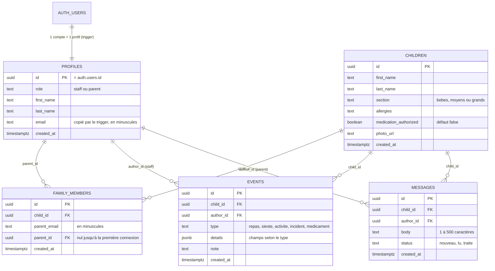

# Modèle de données — Les Petits Pas

Base : Supabase (PostgreSQL), projet `lespetitspas` (local + staging).
Statut : implémenté et vérifié le 20/11/2026 sur ce projet. La production (`lespetitspas-prod`) n'a pas encore reçu ces scripts.

## Schéma

## Tables et contraintes

| Table | Rôle | Contraintes principales |
|---|---|---|
| `profiles` | Un profil par compte d'authentification | `id` = identifiant du compte (suppression en cascade) ; `role` limité à `staff` / `parent` |
| `children` | Fiche de l'enfant | `section` limitée à `bebes` / `moyens` / `grands` ; `medication_authorized` faux par défaut |
| `family_members` | Lien enfant ↔ parent | Unicité (`child_id`, `parent_email`) ; email en minuscules ; `parent_id` nul si le parent ne s'est pas encore connecté |
| `events` | Journal de l'enfant (5 types) | `type` limité aux 5 valeurs ; contrainte `events_details_valid` : champs obligatoires et valeurs contrôlées selon le type |
| `messages` | Messages parent → équipe | `body` de 1 à 500 caractères ; `status` limité à `nouveau` / `lu` / `traite` |

Contenu de `events.details` selon le type :

| Type | Champs obligatoires |
|---|---|
| `repas` | `moment` (matin, midi, gouter), `qualite` (tout, moitie, peu, rien) |
| `sieste` | `debut`, `fin` (HH:MM, fin > début), `qualite` (calme, agitee, reveil_precoce) |
| `activite` | `nom` non vide |
| `incident` | `type` (chute, morsure, fievre, autre), `gravite` (leger, modere, urgent) |
| `medicament` | `nom`, `dose`, `heure` (HH:MM), `autorisation_confirmee` = true |

## Authentification

- Connexion par email et mot de passe. Confirmation de l'email activée, inscriptions publiques désactivées (comptes créés par invitation ou par l'administrateur).
- Trigger `on_auth_user_created` sur `auth.users` : crée le profil avec le rôle `parent` et rattache le parent à ses enfants (`family_members.parent_id`) quand son email correspond.
- Le rôle n'est jamais lu depuis les données envoyées par l'utilisateur (sinon élévation de droits). Le rôle `staff` s'attribue uniquement par SQL.

## Droits et RLS

La RLS est activée sur les 5 tables. Aucune politique n'existe pour un utilisateur non connecté : il n'a aucun accès.

| Table | Parent | Staff |
|---|---|---|
| `profiles` | Lit son profil et celui des auteurs des événements qui concernent ses enfants (affichage du prénom) ; modifie son prénom et son nom (pas le rôle ni l'email) | Lit tous les profils |
| `children` | Lit uniquement ses enfants | Lit, crée, modifie |
| `family_members` | Lit ses propres liens | Lit tous les liens |
| `events` | Lit les événements de ses enfants | Lit tout ; crée (jamais de modification ni de suppression) |
| `messages` | Lit et crée les messages de ses enfants, en son nom, avec le statut `nouveau` | Lit tout ; modifie le statut uniquement |

Règles complémentaires :
- Aucun droit de suppression nulle part pour les utilisateurs connectés.
- `family_members` n'est modifiable que par SQL ou côté serveur.
- Un événement `medicament` n'est accepté que si `children.medication_authorized` est vrai (contrôlé par la base, en plus de l'interface).
- Droits par colonne : seuls `first_name` et `last_name` sont modifiables dans `profiles` ; seul `status` est modifiable dans `messages`.
- Les droits par défaut `REFERENCES`, `TRIGGER` et `TRUNCATE` accordés par Supabase à `anon` et `authenticated` ont été retirés.
- Fonctions `is_staff()` et `is_parent_of()` : `SECURITY DEFINER`, `search_path` vide, exécutables uniquement par les utilisateurs connectés.

## Choix de conception

- **Une seule table `events`** pour 5 types : une chronologie unique par enfant, avec les champs propres à chaque type en `jsonb` validé par contrainte. Contrepartie : les champs ne sont pas des colonnes typées.
- **`family_members` par email** : permet de rattacher un parent avant sa première connexion (invitation). `parent_id` est rempli à la connexion.
- **Pas de statut « journée » stocké** : il se déduit des événements.
- **Statut de message sans accent** (`traite`) pour éviter les problèmes d'encodage.

## Preuves de vérification (20/11/2026, projet `lespetitspas`)

- 5 tables, RLS activée, 20 contraintes observées.
- Trigger actif (`SECURITY DEFINER`, `search_path` vide).
- 17 politiques (16 + 1 correctif de lecture des auteurs, script 06) ; droits par table et par colonne contrôlés.
- 3 comptes de test (1 staff, 2 parents), 30 enfants fictifs, 9 événements, 4 messages.
- Tests d'isolation en SQL (non connecté, parent 1, parent 2, staff) : 48 tests, 0 en échec (à reconfirmer sur la base après le script 06).

## Limites connues

- Tests joués en SQL avec rôles simulés : pas encore de test via l'application ni Playwright (Phases 6 et 8).
- Production non configurée.
- Le flux d'invitation des parents (email Resend) est prévu en Phase 7.

## Scripts

`01_tables.sql`, `02_auth_trigger.sql`, `03_rls.sql`, `06_rls_auteurs.sql`, `04_donnees_test.sql`, `05_tests_isolation.sql` (à exécuter dans cet ordre dans le SQL Editor de Supabase ; le script 06 corrige la lecture du prénom des auteurs d'événements).
